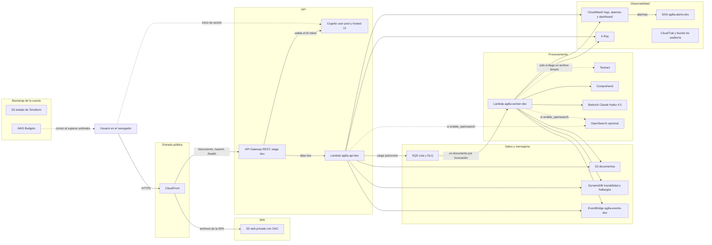

# Arquitectura de AgilIA en AWS (Terraform)

Este documento describe qué crea Terraform en AWS para AgilIA, cómo fluye un documento entre los servicios y qué cambió frente a la plantilla de CloudFormation anterior (eliminada). La guía paso a paso para desplegar está en [despliegue-aws.md](despliegue-aws.md).

Todo se despliega en la región **us-east-2 (Ohio)**. El código de Terraform vive en `infra/terraform/`:

- `bootstrap/`: se ejecuta **una sola vez por cuenta**. Crea el bucket S3 que guarda el estado de Terraform y el presupuesto de AWS Budgets. Su propio estado queda en un archivo local.
- `envs/dev/`: el entorno `dev`. Guarda su estado en el bucket del bootstrap y usa los módulos.
- `modules/`: piezas reutilizables agrupadas por función (almacenamiento, mensajería, login, Lambda, API, frontend, búsqueda, observabilidad).

## Diagrama

Las flechas punteadas son componentes opcionales o pasos que solo ocurren en algunos casos.

## Versión en texto

El mismo flujo, paso a paso:

1. El usuario abre la URL de **CloudFront** (`frontend_url`). CloudFront entrega la SPA (`index.html`, `app.js` y un `config.js` generado por Terraform) desde un **bucket S3 privado** al que solo CloudFront puede leer (Origin Access Control).
2. La SPA redirige al **hosted UI de Cognito** para iniciar sesión (OAuth con código y PKCE). Cognito devuelve un ID token que la SPA guarda en `sessionStorage`.
3. La SPA llama a la API en el **mismo dominio de CloudFront**. Las rutas `/documents*`, `/search*` y `/health` se reenvían a **API Gateway REST** (stage `dev`), sin caché.
4. API Gateway valida el ID token con el **autorizador de Cognito** en todas las rutas, salvo `GET /health`. Luego invoca la **Lambda `agilia-api-dev`** por su alias `live`.
5. Al subir un documento, la Lambda de la API guarda la entrada en **S3** (`uploads/<id>/input.json`), crea el registro `RECEIVED` en **DynamoDB**, envía un mensaje a **SQS** y publica el evento `DocumentUploaded` en **EventBridge**. Responde **202** de inmediato.
6. SQS entrega el mensaje a la **Lambda `agilia-worker-dev`** (un documento por invocación, máximo 2 en paralelo por defecto). El worker ejecuta el pipeline completo: extracción (**Textract**, solo si se envió un archivo binario en `contentBase64`; la SPA envía texto), análisis (**Comprehend**, español), validación y borrador (**Bedrock**, Claude Haiku 4.5 mediante el perfil de inferencia `us.`). Guarda el borrador en S3 y el registro y los hallazgos en DynamoDB. Al terminar publica `DraftReady`.
7. Si el worker falla, SQS reintenta. Tras 3 intentos el documento queda en `ERROR`, se publica `ProcessingFailed` y el mensaje pasa a la **DLQ**.
8. Mientras tanto, la SPA consulta `GET /documents/<id>` cada 3 segundos hasta ver `DRAFTED` o `ERROR`.
9. La búsqueda (`GET /search`) recorre la tabla de hallazgos de DynamoDB. Si se activa `enable_opensearch = true`, usa un dominio de **OpenSearch** con acceso solo por IAM.
10. Las dos Lambdas escriben logs en **CloudWatch Logs** y trazas en **X-Ray**. Cuatro **alarmas de CloudWatch** (errores de la API, errores del worker, 5XX de API Gateway, mensajes en la DLQ) avisan por correo a través de **SNS**. **CloudTrail** guarda las llamadas a la API de AWS en un bucket de auditoría.
11. El **bootstrap** mantiene, aparte del entorno, el bucket del estado de Terraform y **AWS Budgets**, que envía correos al superar USD 20, 50 y 80 en el mes.

## Módulos

| Módulo | Recursos principales | Archivo |
|---|---|---|
| bootstrap (raíz) | Bucket S3 de estado (versionado, cifrado, privado, `prevent_destroy`), presupuesto mensual de AWS Budgets, archivo `envs/dev/backend.hcl` | `infra/terraform/bootstrap/main.tf`, `budget.tf` |
| envs/dev (raíz) | Une los módulos; políticas IAM de las Lambdas; zips de las Lambdas; mapeo SQS → worker | `infra/terraform/envs/dev/main.tf`, `iam.tf`, `lambda.tf` |
| storage | Bucket S3 de documentos, tablas DynamoDB `agilia-traceability-dev` y `agilia-findings-dev`, secreto opcional de reglas | `infra/terraform/modules/storage/main.tf` |
| messaging | Colas SQS `agilia-document-processing-dev` y su DLQ, bus de EventBridge `agilia-events-dev` | `infra/terraform/modules/messaging/main.tf` |
| auth | User pool de Cognito `agilia-users-dev`, grupos `PublicServers` y `BolsaTeam`, dominio del hosted UI, cliente `agilia-web-client-dev` | `infra/terraform/modules/auth/main.tf` |
| lambda_function | Función Lambda (arm64, versión publicada y alias `live`), rol IAM, política, grupo de logs | `infra/terraform/modules/lambda_function/main.tf` |
| api | API Gateway REST `agilia-api-dev`, autorizador de Cognito, rutas de `routes.json`, stage `dev`, permiso de invocación | `infra/terraform/modules/api/main.tf`, `routes.json` |
| frontend | Bucket S3 de la SPA, CloudFront con OAC y origen de API, objetos de `web/` y `config.js` | `infra/terraform/modules/frontend/main.tf` |
| search | Dominio de OpenSearch `agilia-search-dev` (solo si `enable_opensearch = true`) | `infra/terraform/modules/search/main.tf` |
| observability | Tema SNS `agilia-alerts-dev`, 4 alarmas, dashboard `AgilIA-Processing-dev`, grupo X-Ray, CloudTrail `agilia-audit-dev` y su bucket | `infra/terraform/modules/observability/main.tf` |

## Qué cambió frente a la plantilla de CloudFormation

Terraform reemplaza por completo la plantilla de CloudFormation anterior. Lo que se omitió, y por qué:

| Omitido | Motivo |
|---|---|
| VPC, subredes, Internet Gateway, tablas de rutas, grupos de seguridad | Ningún código los necesita. Solo existían para tener OpenSearch dentro de una VPC. |
| NAT Gateway y su IP elástica | Las Lambdas dentro de una VPC lo necesitarían para llegar a Bedrock, Textract y los demás servicios. Cuesta alrededor de USD 33 al mes solo por estar encendido (ver la tabla de costos de la guía). Las Lambdas corren fuera de la VPC. |
| ElastiCache (Redis) | Ningún código usa Redis. |
| Usuario maestro y contraseña de OpenSearch | El dominio usa solo IAM: únicamente los roles de las 2 Lambdas pueden firmar solicitudes. No hay contraseña que guardar. |
| Función clasificadora de operaciones | No había código en el repositorio y usaba un modelo no verificado. El evento `DocumentUploaded` se sigue publicando, así que se puede añadir después. |
| Cadena de 9 Lambdas en Python unidas por reglas de EventBridge | Eran funciones de ejemplo que no ejecutaban el código del repositorio, y la cadena nunca se completaba. Ahora hay 2 Lambdas en TypeScript que ejecutan el pipeline real del repositorio. |
| Logs de ejecución de API Gateway con cuerpo completo | Guardarían el texto de los documentos (datos personales) en CloudWatch. Los errores se ven en los logs y métricas de las Lambdas. |

Lo que se añadió: el frontend (S3 + CloudFront), el dominio de inicio de sesión de Cognito, la ruta `GET /health` sin autenticación para pruebas, el tema SNS de alertas, las alarmas del worker y de 5XX, AWS Budgets y el bucket de estado de Terraform.
